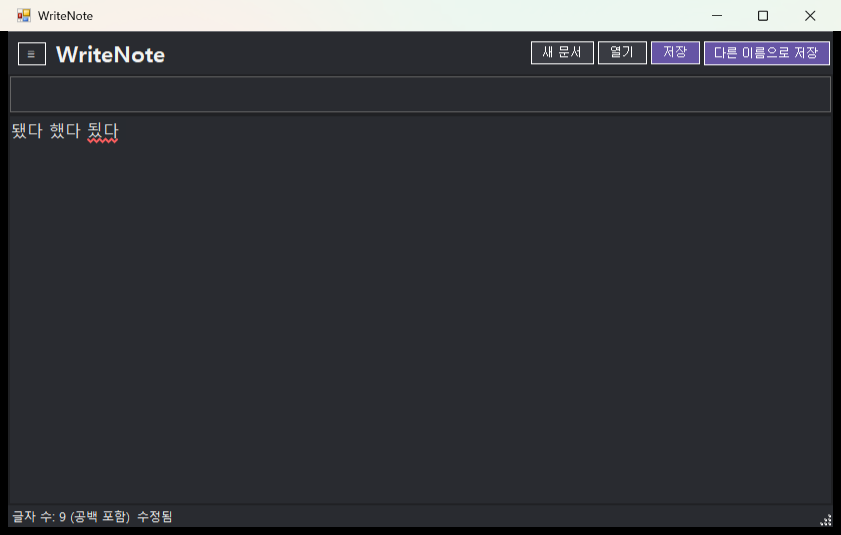
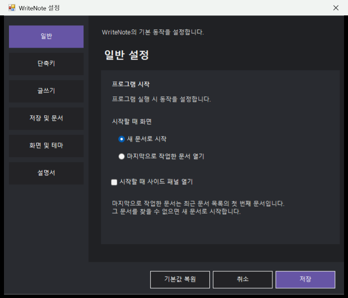
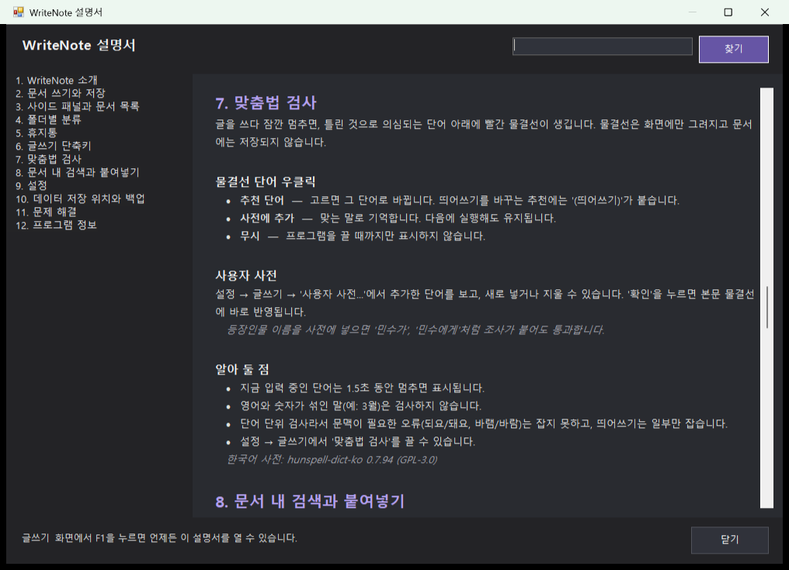
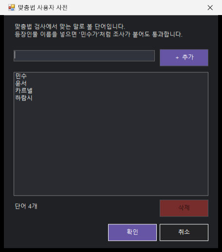

# WriteNote

집중해서 글을 쓰기 위한 Windows 글쓰기 프로그램입니다.
C# Windows Forms(.NET Framework 4.7.2)로 만들었으며, 문서는 RTF 파일로 저장합니다.

## 내려받기

**[⬇ 최신 버전 내려받기 (WriteNote.exe)](https://github.com/WhiteHorang/WriteNote/releases/latest)**

Release 페이지에서 `WriteNote.exe`를 받아 실행하면 됩니다. 설치는 필요 없습니다.

- 실행 조건: Windows 10/11 (.NET Framework 4.7.2 이상, Windows에 기본 포함)
- 처음 실행할 때 "Windows의 PC 보호" 창이 뜨면 **추가 정보 → 실행**을 누르세요. (서명하지 않은 프로그램이라 나오는 안내입니다)

## 주요 기능

- **글쓰기**: 제목 + 본문, 글자 수(공백 포함/제외), 자동 저장, 저장하지 않은 내용 확인
- **문서 관리**: 사이드 패널 문서 목록(전체·최근·즐겨찾기), 검색·정렬, 폴더별 분류(하위 폴더), 휴지통과 복원
- **글쓰기 단축키**: 말줄임표 `⋯`, 겹낫표 `「」`, 따옴표, 구분선, 세 줄 띄우기 등. 직접 추가·수정·삭제 가능
- **한국어 맞춤법 검사**: 틀린 것으로 의심되는 단어에 빨간 물결선, 우클릭으로 추천 단어·사전에 추가·무시, 사용자 사전 관리
- **화면**: 어두운/밝은 테마(프로그램 전체), 본문 글꼴·글자 크기
- **설정**: 일반 · 단축키 · 글쓰기 · 저장 및 문서 · 화면 및 테마 (JSON으로 저장, 바로 적용)
- **설명서**: 프로그램 안에서 F1 (또는 설정 > 설명서)

| 설정 | 설명서 | 맞춤법 사용자 사전 |
|---|---|---|
|  |  |  |

자세한 기능 목록은 [docs/WriteNote_기능_정리.md](docs/WriteNote_기능_정리.md)에 있습니다.

## 빌드

실행 파일은 **`WriteNote.exe` 하나**입니다. 필요한 구성 요소와 맞춤법 사전이 빌드할 때 exe 안에 들어갑니다.

1. Visual Studio(.NET 데스크톱 개발 워크로드)에서 `WriteNote.slnx`를 엽니다.
2. 빌드하면 NuGet 패키지(`packages/`)를 자동으로 받습니다.
   명령줄로 빌드할 때는 먼저 `nuget restore WriteNote.slnx` (또는 `msbuild -t:restore -p:RestorePackagesConfig=true`)를 실행합니다.
3. Release로 빌드하면 `WriteNote/bin/Release/WriteNote.exe` 하나가 배포용 실행 파일입니다.
   (`.exe.config`, `.pdb`는 빌드 부산물이라 배포에 필요 없습니다)

## 프로젝트 구조

| 경로 | 내용 |
|---|---|
| `WriteNote/WriteNoteForm*.cs` | 메인 화면 (기능별로 나뉜 partial 파일: Editor, Documents, DocumentList, DocumentMenu, Folders, Trash, Spelling, Settings) |
| `WriteNote/SettingsForm.cs`, `ShortcutEditForm.cs`, `UserDictionaryForm.cs`, `HelpForm.cs` | 설정 창, 단축키 입력 창, 사용자 사전 창, 설명서 창 |
| `WriteNote/*Manager.cs`, `AppSettings.cs` | 설정·단축키·최근 문서·휴지통 저장과 불러오기 |
| `WriteNote/SpellCheckService.cs` | 한국어 맞춤법 검사 |
| `WriteNote/ThemeManager.cs` | 어두운 ↔ 밝은 테마 색 바꾸기 |
| `WriteNote/EmbeddedAssemblies.cs` | exe 하나로 배포하기 위해 exe 안의 DLL을 꺼내 쓰는 코드 |
| `WriteNote/Dictionaries/`, `WriteNote/Licenses/` | 맞춤법 사전과 외부 구성 요소 라이선스 (빌드할 때 exe 안에 들어감) |
| `docs/` | 기능 정리, 통합 테스트 체크리스트, 개발 현황 문서 |
| `tests/` | 자동 통합 테스트와 한글 입력 확인 스크립트 ([tests/README.md](tests/README.md)) |

## 데이터 저장 위치

| 데이터 | 위치 |
|---|---|
| 문서 (.rtf + .json) | `내 문서\WriteNote` (설정에서 변경 가능) |
| 설정 · 단축키 · 최근 문서 · 휴지통 · 맞춤법 사용자 사전 | `%AppData%\WriteNote` |

## 테스트

자동 통합 테스트 108개 항목 (실제 사용자 데이터는 쓰지 않음). 실행 방법은 [tests/README.md](tests/README.md)를 참고하세요.

## 사용한 외부 구성 요소

| 구성 요소 | 라이선스 |
|---|---|
| [Newtonsoft.Json](https://www.newtonsoft.com/json) 13.0.4 | MIT |
| [WeCantSpell.Hunspell](https://github.com/aarondandy/WeCantSpell.Hunspell) 7.0.1 | MPL 1.1 / GPL 2.0 / LGPL 2.1 |
| [hunspell-dict-ko](https://github.com/spellcheck-ko/hunspell-dict-ko) 0.7.94 (한국어 맞춤법 사전) | GPL-3.0 |
| System.Memory, System.Buffers, System.Numerics.Vectors, System.Runtime.CompilerServices.Unsafe | MIT (Microsoft) |

모두 수정하지 않고 그대로 사용합니다. 버전별 원본 소스 위치와 저작권 고지는 [THIRD-PARTY-NOTICES.md](THIRD-PARTY-NOTICES.md)에,
라이선스 전문은 `WriteNote/Licenses/`, `WriteNote/Dictionaries/` 폴더와 프로그램 설명서 13장에 있습니다.
